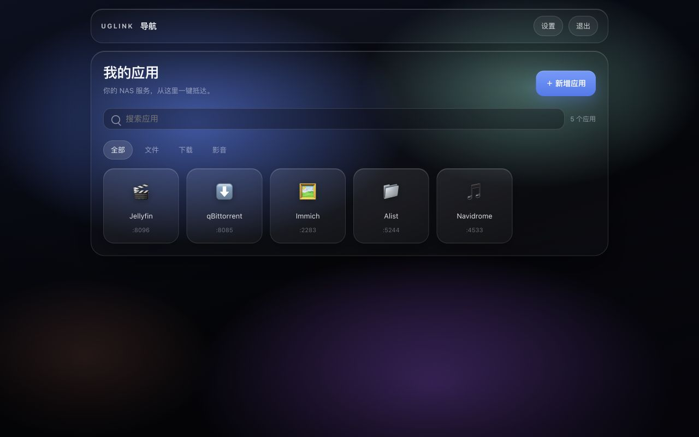
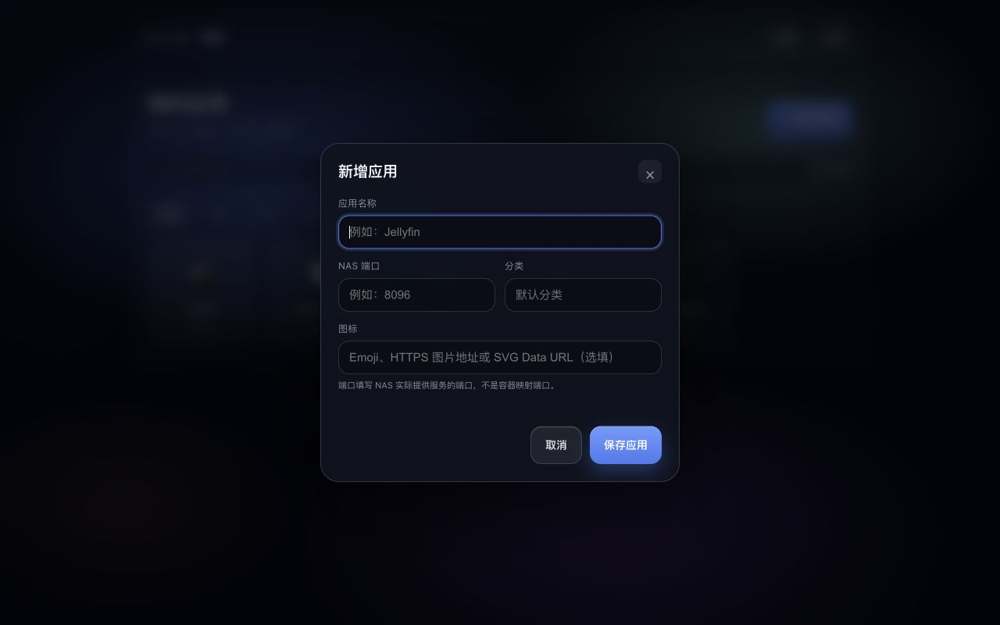
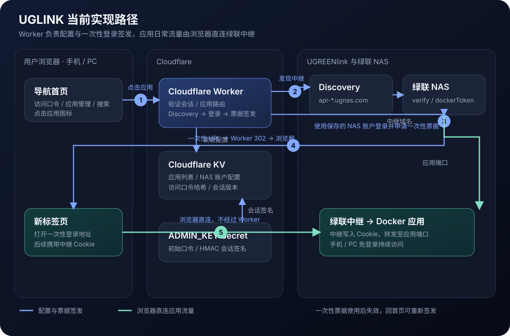

# uglink-nav

部署在 Cloudflare Workers 上的绿联 NAS 应用导航页。点击应用时，Worker 通过保存的 NAS 账户在 UGREENlink 签发一次性登录票据，再由浏览器直接连接绿联中继，实现在手机端或者 PC 端免登录访问绿联 NAS 中的 Docker 应用。

## 截图





## 实现路径



图中展示了配置读取、一次性登录票据签发，以及后续浏览器直连中继的完整链路。

## 功能

- 首页新增、编辑和删除 NAS 应用，配置持久化到 Cloudflare KV。
- 应用菜单可复制一次性登录链接，链接含临时凭据且打开后失效。
- 应用搜索、分类筛选、Emoji / HTTPS / SVG Data URL 图标。
- 应用在新标签页打开，保留 UGREENlink 一键登录流程。
- 独立 NAS 凭据设置，修改访问口令需验证原口令和两次新口令。
- 访问口令哈希存储，修改后使所有旧会话失效。
- 响应式液态玻璃界面，WebGL 不可用时自动回退。

## 快速开始

```bash
npm install
npx wrangler login
npx wrangler kv namespace create CONFIG
```

将 KV ID 和部署域名填入 `wrangler.jsonc`，然后：

```bash
npx wrangler secret put ADMIN_KEY
npm run deploy
```

完整的 Cloudflare 注册、权限、KV、域名和验证步骤见 [DEPLOY.md](DEPLOY.md)。

非 Docker 应用可通过 `marcnuri/port-forward` 容器中转端口后添加，具体配置见 [非 Docker 应用教程](DEPLOY.md#47-添加非-docker-应用通过-docker-中转端口)。

## 本地开发

```bash
cp .dev.vars.example .dev.vars
npm install
npm run dev
```

编辑 `.dev.vars` 设置本地测试口令。该文件已被 Git 排除，不要提交真实凭据。

## 安全说明

NAS 密码保存在 Cloudflare KV 的配置 JSON 中。请使用专用低权限 NAS 账号，保护 Cloudflare 账户，并不要提交 `.dev.vars`、API Token 或真实口令。

## License

MIT
